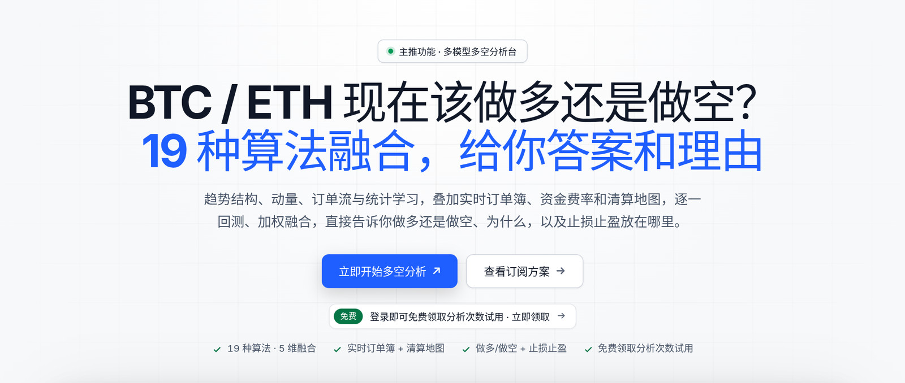
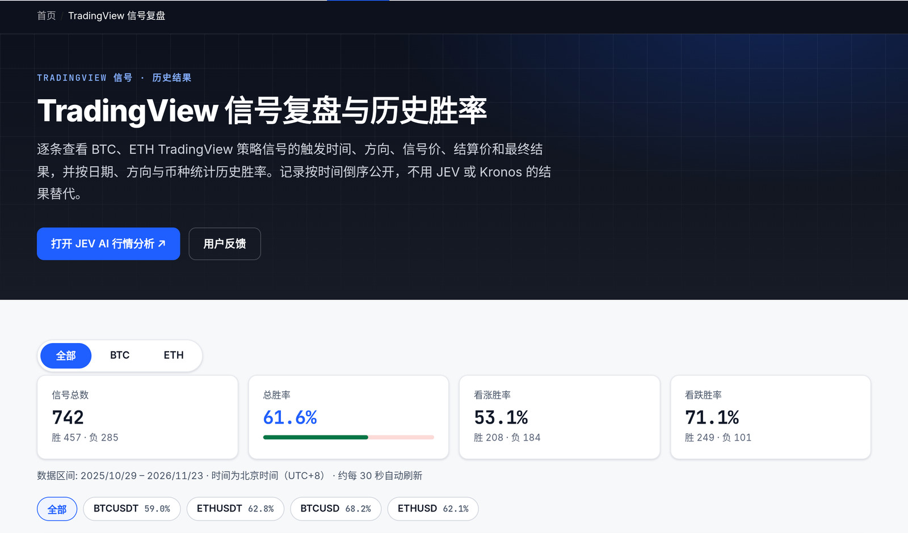
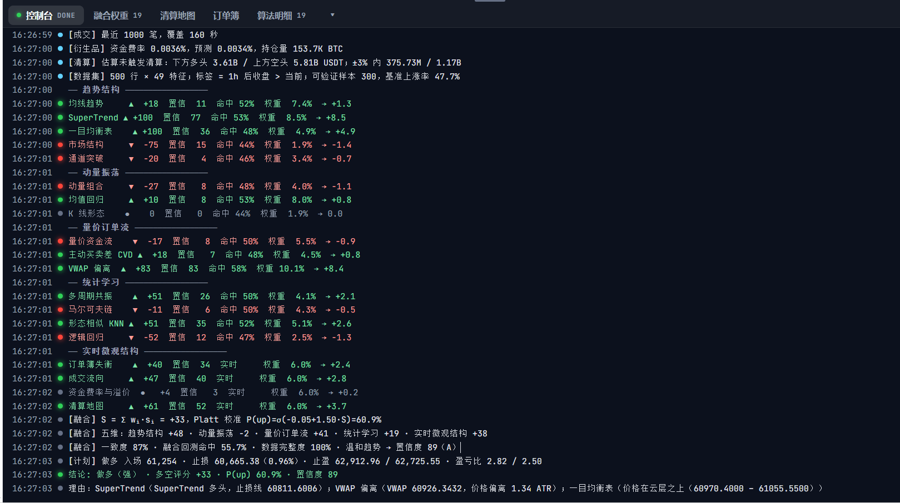
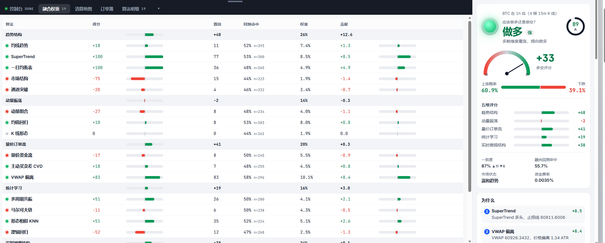
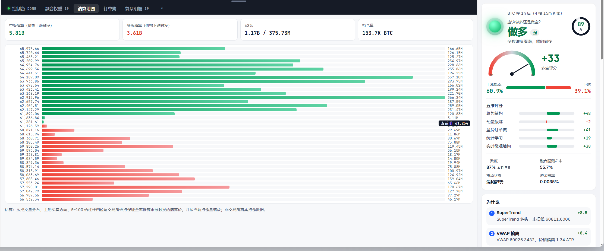

# Coinpred: event-contract forecasts, Kronos candle predictions, and public trading signals

**Languages:** [English](README.en.md) · [简体中文](README.md)

## Contact me

Questions, partnerships or feedback — reach me directly:

- Telegram: [@DUCKS88896h](https://t.me/DUCKS88896h)
- Email: [3211caoq@gmail.com](mailto:3211caoq@gmail.com)

Or scan the Telegram QR code:

[Coinpred](https://coinpred.com) is an AI market-analysis toolkit for BTC and ETH. It puts a 19-algorithm fused long/short call, [Kronos foundation-model candle forecasts](https://coinpred.com/kronos), event-contract direction checks, and a public TradingView signal ledger on one site, so you can ask:

**Is the evidence leaning long or short right now, how was that evidence built, and how far should you trust it?**

- Site: [coinpred.com](https://coinpred.com)
- Kronos forecasts: [coinpred.com/kronos](https://coinpred.com/kronos)
- Public daily archive: [coinpred.com/kronos-daily](https://coinpred.com/kronos-daily)
- Event contracts: [What is a BTC event contract?](https://coinpred.com/news/btc-event-contracts/)
- JEV and confidence: [JEV model notes](https://coinpred.com/news/jev-model/)
- Public signal win rate: [TradingView signal review](https://coinpred.com/review)
- How to use: [tutorial](https://coinpred.com/news/how-to-use/)

New accounts can claim free analysis credits each day. Model output and historical win rates are for research only. They are not investment advice and not an order ticket. The service is not available to users in mainland China.

## What this repository is

Public, illustrated documentation for [Coinpred](https://coinpred.com), written so people can find the product through keywords such as event-contract forecasts, free event-contract signals, Kronos K-line prediction, BTC/ETH direction analysis, 19-algorithm fusion, liquidation maps, and signal win rates.

| Topic | English | 简体中文 |
| --- | --- | --- |
| How the 19 algorithms are fused, and where the evidence comes from | [docs/en/signal-lab.md](docs/en/signal-lab.md) | [docs/zh/signal-lab.md](docs/zh/signal-lab.md) |
| How JEV works, and what confidence means | [docs/en/jev.md](docs/en/jev.md) | [docs/zh/jev.md](docs/zh/jev.md) |
| Kronos candle forecasts | [docs/en/kronos.md](docs/en/kronos.md) | [docs/zh/kronos.md](docs/zh/kronos.md) |
| How to read automated signal win rates | [docs/en/signals.md](docs/en/signals.md) | [docs/zh/signals.md](docs/zh/signals.md) |
| Event-contract forecasts | [docs/en/event-contracts.md](docs/en/event-contracts.md) | [docs/zh/event-contracts.md](docs/zh/event-contracts.md) |
| When analysis is more usable, and when you should not place an order | [docs/en/decision.md](docs/en/decision.md) | [docs/zh/decision.md](docs/zh/decision.md) |

## Keep these systems separate

Coinpred ships several independent tools. Their inputs, outputs, and published track records are not interchangeable:

| Tool | Based on | Outputs | Published win rate? |
| --- | --- | --- | --- |
| 19-algorithm fusion | Trend, momentum, order-flow and statistical models, plus the live order book, funding and liquidation map, weighted by each model's backtested reliability | Long/short, score, calibrated P(up), reasons and a trade plan | **The site does not yet publish a contract-settled win-rate table for fusion calls themselves.** The on-screen “backtest hit rate” is an in-tool historical fit for each algorithm, not a live trading record |
| JEV direction | TypeSafe AI’s System One model (RLCD). Inputs: 200 Binance spot candles, 12 program-computed indicators, WEEX book depth and recent trades | A five-level direction, a probability distribution, confidence, and program-assembled evidence | **No out-of-sample JEV win rate or event-contract payout probability has been published.** Confidence is not a win rate |
| Kronos forecasts | The open-source Kronos candle foundation model ([arXiv 2508.02739](https://arxiv.org/abs/2508.02739), AAAI 2026); last 512 candles as context | Future OHLC candles, plus a public daily archive versus later closes | The archive reports close error versus later realized closes. **That is not a trading return or an order win rate** |
| TradingView signal review | Settled TradingView strategy signals — not JEV, not Kronos | Direction, signal price, settlement price, win/loss | **This is the public, row-by-row automated signal win rate on the site.** Always re-check the [live review page](https://coinpred.com/review) |

## Public automated signal win rate (TradingView review)

Figures below were checked on 2026-11-23 from the [TradingView signal review](https://coinpred.com/review). The page title is “TradingView signal review and historical win rate.” Records are published newest first and **do not stand in for JEV or Kronos results**. The page refreshes about every 30 seconds; quote the live page when you reuse the numbers.

- 742 settled signals (457 wins · 285 losses)
- Overall win rate 61.6%
- Long: 53.1% (208 wins · 184 losses)
- Short: 71.1% (249 wins · 101 losses)
- Per symbol: BTCUSDT 59.0%, ETHUSDT 62.8%, BTCUSD 68.2%, ETHUSD 62.1%
- Sample window: 2025-10-29 to 2026-11-23 (the page labels times as Beijing time, UTC+8)

On the same day’s table, 2026-11-23 itself showed 6 signals and a 50.0% win rate for that day, with both wins and losses. That is a single-day sample, not the full history, and not a JEV or Kronos result.

How the page defines a win:

- Win rate = wins ÷ (wins + losses). Unsettled signals are excluded.
- “Win / loss” only means the signal direction matched the settlement; the percent change is settlement versus signal price, not a fee-adjusted P&L.
- The review states that these records **do not stand in for JEV or Kronos results**.
- Past win rates do not imply future results, and they do not endorse every script in the strategy store.

See [How to read automated signal win rates](docs/en/signals.md) for the full note.

## 19-algorithm fusion: scores, weights and reasons

The fusion console reads recent trades, funding, open interest and liquidation structure, then weights 19 algorithm scores into a direction and a trade plan.

The three images below are a real run (BTC/USDT, 15-minute candles, 1-hour window). The numbers move with the market. They explain how to read the screen, not what happens next.

**Console:** live scores on the left; fused direction, score, stop and targets at the bottom.

**Weights:** each algorithm shows its score, backtest hit rate, weight and contribution to this call.

**Liquidation map:** short liquidations above the current price, long liquidations below it.

On the board, the fused score is `S = Σ (w_i × s_i)`, then Platt calibration produces `P(up)`. The board also shows per-group contributions, agreement, entry, stop and targets. Those values belong to that run. They are not a published long-run live win rate. Details: [How the algorithms are fused](docs/en/signal-lab.md).

## What confidence is — and why it is not an order

JEV confidence follows TypeSafe’s public description: the model returns a probability distribution over the five direction choices, then a 0–1 confidence from how concentrated that distribution is. Coinpred displays the direction answer’s `confidence × 100%`. The official docs do not publish the exact formula, so this repository does not treat “top-choice probability” or “entropy” as the official algorithm.

Sources: [TypeSafe Confidence](https://docs.typesafe.ai/confidence) · [Introducing Jev](https://typesafe.ai/blog/introducing-system-one-models-and-jev) · [JEV 1.13 known limitations](https://docs.typesafe.ai/model-jaggedness/jev-1.13)

The site’s own wording is the important one: **directional confidence measures how certain this classification is; it is not an event-contract win probability.** An 80% reading does not mean that class of trades has an 80% historical win rate. Coinpred has not published out-of-sample JEV validation, calibration curves or Brier scores. See [How JEV works](docs/en/jev.md).

## When analysis is more usable, and when you should not place an order

Treat every output as a structured second opinion, not an automated trade ticket. Evidence is usually more usable when the probability mass is concentrated, neighboring timeframes agree, the leading fusion weights are not fighting the liquidation map, you already understand the venue’s expiry and payout, and the size is one you can afford to lose.

Stand aside rather than order when the call is neutral, the distribution is spread out, timeframes disagree, the stop sits in a liquidation cluster, you have not read the settlement rules, or you are only reacting to a high confidence number.

The full checklist is in [When analysis is usable, and when not to place an order](docs/en/decision.md).

## Getting started

1. Open [coinpred.com](https://coinpred.com) and sign up with email or Google.
2. Claim the daily free analysis credits.
3. Pick a market and timeframe: JEV for event-contract direction, [Kronos](https://coinpred.com/kronos) for the next candles, the fusion console for a weighted long/short plan.
4. Check the evidence, weights, liquidations and distribution against the [decision checklist](docs/en/decision.md) and your own rules.
5. Subscribe only if you need more credits or strategy source. The site lists $18 / month or $168 / year, paid by card or USDT; the live pricing page wins if it changes.

The walkthrough is in the [tutorial](https://coinpred.com/news/how-to-use/).

## Other links

- Site: [https://coinpred.com](https://coinpred.com)
- Telegram: [@DUCKS88896h](https://t.me/DUCKS88896h)
- Email: [3211caoq@gmail.com](mailto:3211caoq@gmail.com)
- X: [@xbluev](https://x.com/xbluev)
- GitHub: [@Boom-Caoq](https://github.com/Boom-Caoq)

## Disclaimer

Model outputs, fusion scores, confidence values and signal reviews are for research only. They do not guarantee accuracy and are not investment advice. Event contracts and other derivatives can take the entire stake if the direction is wrong. Confirm that this product is legal where you are. The service is not available to users in mainland China.
