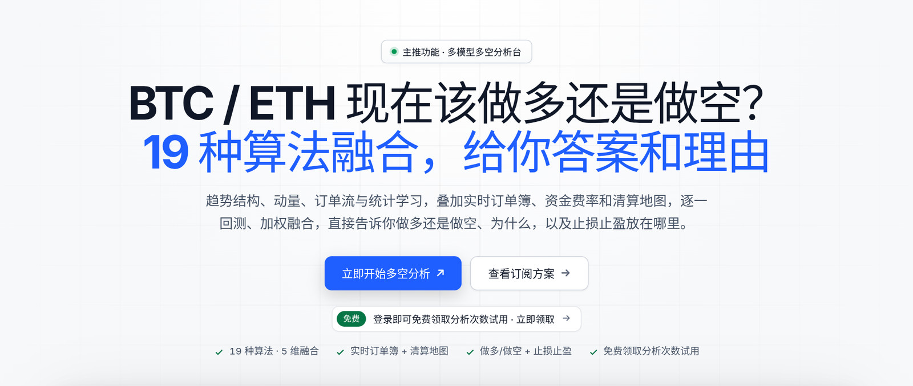
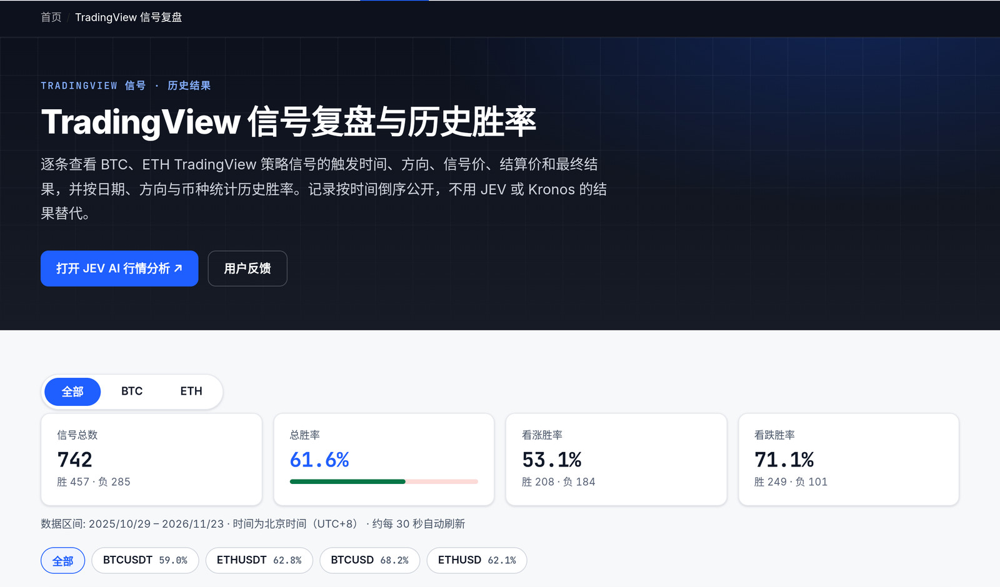
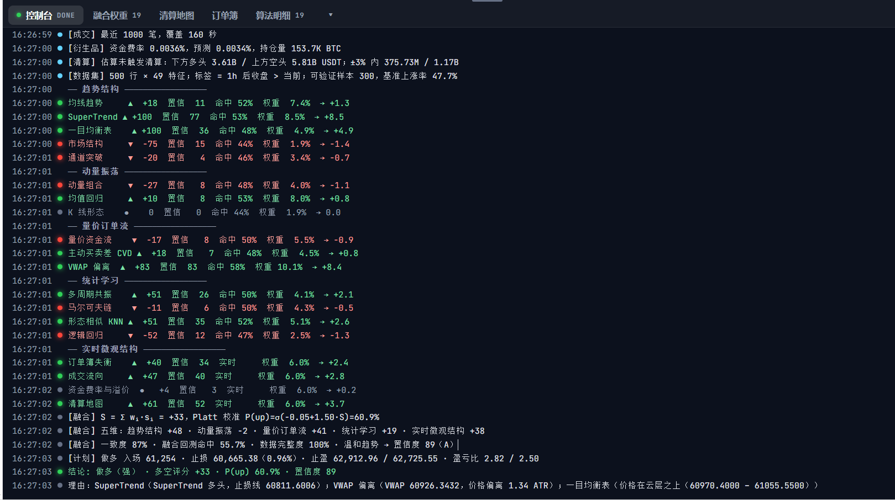
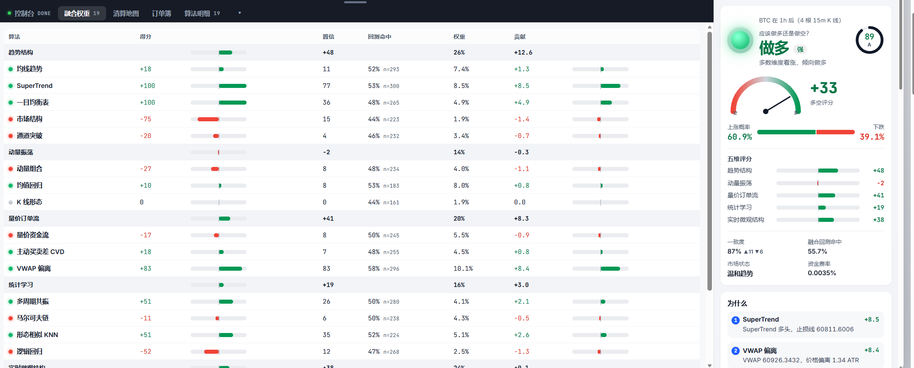
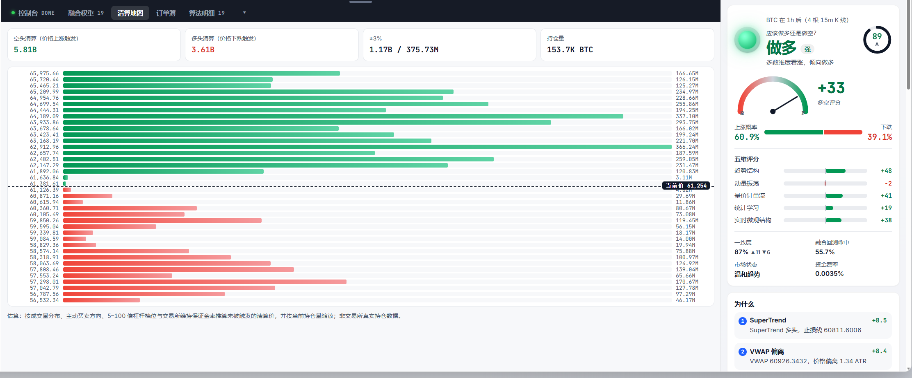

# Coinpred：事件合约预测、Kronos K 线预测与免费行情信号

**Languages:** [简体中文](README.md) · [English](README.en.md)

## 联系我

有问题、合作或反馈，直接找我：

- Telegram：[@DUCKS88896h](https://t.me/DUCKS88896h)
- 邮箱：[3211caoq@gmail.com](mailto:3211caoq@gmail.com)

扫码加 Telegram：

[Coinpred](https://coinpred.com/zh) 是面向 BTC / ETH 的 AI 行情分析工具。它把 19 种算法的融合结论、[Kronos 金融模型 K 线预测](https://coinpred.com/zh/kronos)、事件合约方向判断，以及公开的 TradingView 信号复盘放在同一个站点里，用来回答：

**现在更该做多，还是做空？依据是什么？这份依据能信到什么程度？**

- 网站：[coinpred.com](https://coinpred.com/zh)
- Kronos K 线预测：[coinpred.com/zh/kronos](https://coinpred.com/zh/kronos)
- 每日公开预测归档：[coinpred.com/zh/kronos-daily](https://coinpred.com/zh/kronos-daily)
- 事件合约说明：[BTC 事件合约是什么](https://coinpred.com/zh/news/btc-event-contracts/)
- JEV 模型与置信度：[JEV 模型说明](https://coinpred.com/zh/news/jev-model/)
- 公开信号胜率：[TradingView 信号复盘](https://coinpred.com/zh/review)
- 使用教程：[玩法教程](https://coinpred.com/zh/news/how-to-use/)

注册后每天可免费领取分析次数。模型输出和历史胜率都只供研究参考，不构成投资建议，也不能直接当成下单指令。本服务不面向中国大陆地区用户开放。

## 这个仓库是什么

本仓库是 [Coinpred](https://coinpred.com/zh) 的公开图文说明，方便检索这些关键词：事件合约预测、免费事件合约信号、Kronos 金融模型 K 线预测、BTC / ETH 涨跌预测、19 种算法融合、清算地图、信号胜率。

详细文档（中英对照）：

| 主题 | 简体中文 | English |
| --- | --- | --- |
| 19 种算法怎么融合、依据从哪来 | [docs/zh/signal-lab.md](docs/zh/signal-lab.md) | [docs/en/signal-lab.md](docs/en/signal-lab.md) |
| JEV 怎么工作、置信度是什么 | [docs/zh/jev.md](docs/zh/jev.md) | [docs/en/jev.md](docs/en/jev.md) |
| Kronos 金融模型 K 线预测 | [docs/zh/kronos.md](docs/zh/kronos.md) | [docs/en/kronos.md](docs/en/kronos.md) |
| 自动信号胜率怎么读 | [docs/zh/signals.md](docs/zh/signals.md) | [docs/en/signals.md](docs/en/signals.md) |
| 事件合约预测 | [docs/zh/event-contracts.md](docs/zh/event-contracts.md) | [docs/en/event-contracts.md](docs/en/event-contracts.md) |
| 什么情况下分析更可参考，什么情况下不该下单 | [docs/zh/decision.md](docs/zh/decision.md) | [docs/en/decision.md](docs/en/decision.md) |

## 先分清三套东西，不要混用胜率

Coinpred 里至少有三套彼此独立的能力。它们的数据来源、输出含义和有没有公开战绩都不一样：

| 能力 | 基于什么 | 输出什么 | 有没有公开胜率 |
| --- | --- | --- | --- |
| 19 种算法融合 | 趋势、动量、订单流、统计学习，再叠加订单簿、资金费率、清算地图；按各算法回测可靠性加权 | 做多 / 做空、多空评分、校准后的上涨概率、理由和交易计划 | **站点尚未把融合结论本身做成公开、可按合约规则结算的胜率表**。控制台里的「回测命中」是各算法在工具内部的历史拟合，不能拿来代替实盘战绩 |
| JEV 方向判断 | TypeSafe AI 的 System One 模型（RLCD）；输入为 200 根 Binance 现货 K 线、12 项程序计算的指标、WEEX 盘口与近期成交 | 五档方向、概率分布、置信度、程序整理的依据 | **本站没有发布 JEV 的样本外胜率或事件合约获胜概率**。置信度不是胜率 |
| Kronos K 线预测 | 开源金融基础模型 Kronos（论文 [arXiv 2508.02739](https://arxiv.org/abs/2508.02739)，AAAI 2026）；读取最近 512 根 K 线 | 未来 K 线的开高低收，以及每日公开归档里的预测与实际收盘对照 | 日线归档会公布预测收盘与实际收盘的误差，**这不是交易收益率，也不是下单胜率** |
| TradingView 策略信号复盘 | 已触发并结算的 TradingView 策略信号，不是 JEV，也不是 Kronos | 方向、信号价、结算价、胜负 | **这是目前站点上公开、可逐条核对的自动信号胜率**。请以 [复盘页](https://coinpred.com/zh/review) 的实时数字为准 |

## 公开自动信号胜率（TradingView 复盘）

以下数字来自 2026-11-23 对 [TradingView 信号复盘](https://coinpred.com/zh/review) 的核对。页面标题为「TradingView 信号复盘与历史胜率」。记录按时间倒序公开，**不是 JEV 或 Kronos 结果的替代**。页面约每 30 秒自动刷新，引用时请回看实时页面。

- 已结算信号 742（胜 457 · 负 285）
- 总胜率 61.6%
- 看涨 / 做多：53.1%（胜 208 · 负 184）
- 看跌 / 做空：71.1%（胜 249 · 负 101）
- 分币种：BTCUSDT 59.0%，ETHUSDT 62.8%，BTCUSD 68.2%，ETHUSD 62.1%
- 数据区间：2025/10/29 – 2026/11/23（页面标注为北京时间 UTC+8）

同一天的表格上，2026-11-23 这一日为 6 条信号、当日胜率 50.0%，有胜有负。这只是单日样本，不是全部历史，也不是 JEV 或 Kronos 的结果。

阅读规则（复盘页原文口径）：

- 胜率 = 胜 ÷（胜 + 负），未结算信号不计入。
- 「胜 / 负」只表示信号方向与结算结果是否一致；涨跌是结算价相对信号价的变化，不是计费后的盈亏。
- 复盘写明：**记录不用 JEV 或 Kronos 的结果替代**。
- 历史胜率不代表未来表现，也不能为策略商店里所有脚本背书。

更完整的读法见 [自动信号胜率怎么读](docs/zh/signals.md)。

## 19 种算法融合：分数、权重和理由

融合控制台会先读近期成交、资金费率、持仓量和清算分布，再把 19 路算法的分数按权重加总，输出方向和交易计划。

下面三张图是一次真实运行界面（BTC/USDT，15 分钟 K 线，1 小时窗口）。数字会随行情变化，只用来说明怎么读，不代表未来结果。

**控制台总览**：左侧是 19 路算法的实时分数，底部给出融合后的方向、多空评分、止损和止盈。

**融合权重**：每一路都能看到得分、回测命中、权重和这次的贡献。

**清算地图**：当前价格上方是空头清算，下方是多头清算。

界面里，融合分 `S` 是各算法分数的加权和：`S = Σ (w_i × s_i)`，再经过 Platt 校准得到上涨概率 `P(up)`。还会给出分维度贡献、一致度，以及入场、止损、止盈。这些都是当次计算的结果，不是已公布的长期实盘胜率。细节见 [算法如何融合](docs/zh/signal-lab.md)。

## 置信度是什么，为什么不能拿去下单

JEV 的置信度来自 TypeSafe 官方说明：模型对五个方向给出概率分布，再据此得到 0–1 的 confidence；分布越集中，判断越明确，越分散，不确定性越大。Coinpred 显示的是方向问题返回的 `confidence × 100%`。官方公开文档没有披露具体公式，因此本仓库也不把「最高选项概率」或「熵」写成官方算法。

[来源：TypeSafe Confidence](https://docs.typesafe.ai/confidence) · [JEV 介绍](https://typesafe.ai/blog/introducing-system-one-models-and-jev) · [JEV 1.13 已知局限](https://docs.typesafe.ai/model-jaggedness/jev-1.13)

最重要的一条（站点原文口径）：**方向置信度衡量的是这次分类有多确定，不能直接解释为事件合约的获胜概率。** 即使显示 80%，也不代表这类交易已有 80% 的历史胜率。本站目前没有发布 JEV 的样本外验证、校准曲线或 Brier 分数。详见 [JEV 怎么工作](docs/zh/jev.md)。

## 什么情况下分析更可参考，什么情况下不该下单

把任何一次输出都当成「结构化的第二意见」，而不是自动交易信号。更可参考的情形通常是：概率分布集中、相邻周期方向一致、融合权重里的主导算法和清算地图没有明显打架、你已经看清所用平台的到期时间和赔付比例，并且仓位是自己能承受的。

出现下面这些情况，更应该观望，而不是下单：结论为中性、概率很分散、不同周期互相打架、止损正好落在密集清算区、你还没看清结算规则，或者只是因为置信度数字看起来高。

完整清单见 [分析何时可参考，何时不该下单](docs/zh/decision.md)。

## 怎么开始

1. 打开 [coinpred.com/zh](https://coinpred.com/zh)，用邮箱或 Google 注册。
2. 每天领取免费分析次数。
3. 选币种和周期：事件合约方向判断用 JEV；看未来 K 线用 [Kronos](https://coinpred.com/zh/kronos)；看多空理由用融合控制台。
4. 先核对依据、权重、清算和概率分布，再对照 [决策清单](docs/zh/decision.md) 和自己的规则。
5. 需要更多次数和策略源码时再订阅。站点标价为月付 $18 / 年付 $168，银行卡与 USDT 均可，以页面当时显示为准。

操作步骤见 [玩法教程](https://coinpred.com/zh/news/how-to-use/)。

## 其他入口

- 网站：[https://coinpred.com](https://coinpred.com/zh)
- Telegram：[@DUCKS88896h](https://t.me/DUCKS88896h)
- 邮箱：[3211caoq@gmail.com](mailto:3211caoq@gmail.com)
- X：[@xbluev](https://x.com/xbluev)
- GitHub：[@Boom-Caoq](https://github.com/Boom-Caoq)

## 免责声明

模型输出、融合分数、置信度和信号复盘都只供研究参考，不保证准确，也不构成投资建议。事件合约等衍生品风险较高，判断错误时可能损失全部投入。请确认你所在地区允许参与此类产品。本服务不面向中国大陆地区用户开放。
