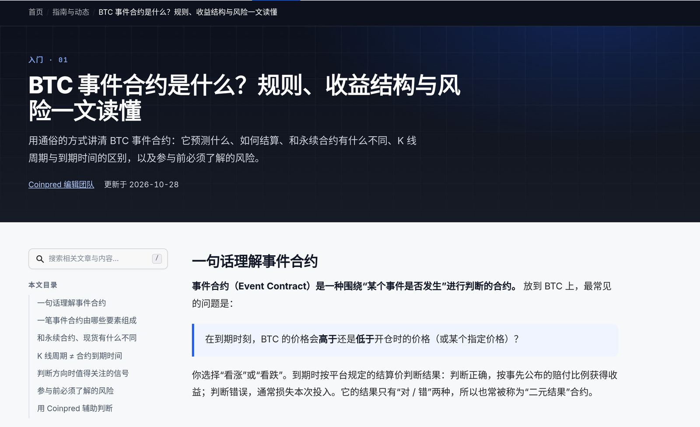

# Event-contract forecasts and free analysis credits

**Languages:** [English](event-contracts.md) · [简体中文](../zh/event-contracts.md)

An event contract asks a yes-or-no question: at expiry, will the price of BTC or ETH be above or below a reference price? A correct call pays the venue’s stated payout ratio; a wrong call usually loses the stake.

The full explainer is [What is a BTC event contract? Rules, payout structure and risks](https://coinpred.com/news/btc-event-contracts/) (updated 2026-10-28 on the site).

There is also a Binance-specific note, [Binance event contracts: access, settlement and API questions](https://coinpred.com/news/binance-event-contracts/) (updated the same day). Coinpred cannot enable an exchange product for you or change your account eligibility. Before you place anything, the venue’s own official rules still govern.

[Coinpred](https://coinpred.com) does not place the order for you. It sends live candles, the order book, recent trades and 12 technical indicators to the JEV model, and returns a five-level direction, a confidence reading and assembled evidence — technical context for an **event-contract forecast**. New accounts can claim **free analysis credits** each day. That output is not a promise that any one contract will pay, and the site has not published a JEV event-contract win probability.

## Event contracts in one sentence

The site’s own wording is that an event contract is a contract on whether a specific event happens. On BTC, the most common question is:

**At expiry, will BTC’s price be above or below the price at entry (or some specified level)?**

You choose “up” or “down”. At expiry the venue’s settlement price decides the result: a correct call pays the pre-announced payout ratio; a wrong call usually loses the stake. There are only two outcomes, which is why these are often called binary-outcome contracts.

Venue rules are not identical, but they usually include the items below. Read each one before you trade:

| Element | Meaning |
| --- | --- |
| Underlying | For example BTC/USDT or ETH/USDT |
| Direction | Up (expiry price above entry) or down (expiry price below entry) |
| Expiry | For example 10 minutes, 30 minutes, 1 hour or 1 day, as offered by the venue |
| Settlement price | The price source and the rule the venue uses to take it |
| Payout ratio | What a correct call pays; a wrong call usually loses the entire stake |
| Tie rule | What happens if the expiry price equals the entry price |

## How this differs from spot and perpetuals

- **Spot:** you hold the asset itself, and P&L moves continuously with price.
- **Perpetual futures:** leveraged, continuous P&L. Every tick moves the result, with liquidation risk and funding.
- **Event contracts:** only the direction at the expiry moment matters. P&L is largely fixed at entry (a set ratio if you are right, the stake if you are wrong). There is no liquidation, but a wrong direction typically costs the *entire* stake, not part of it.

So the useful question is: over this window, which way is the evidence stronger? That is the question JEV is meant to organise. Do not treat a fusion-console trade plan, or a Kronos path of future candles, as the expiry call on a particular event contract.

## The candle interval is not the contract expiry

This is the easiest point to mix up. In Coinpred you can choose a **candle interval** such as 1m, 5m, 15m, 1h, 4h or 1d. That is the resolution you use to *look at* the market. It is **not** the event-contract expiry.

A common approach is to watch a timeframe close to or slightly longer than the expiry for the trend, and a shorter one for timing — for example, 15m and 1h structure when the contract expires in one hour. That is only a way of looking. It does not guarantee the result.

## How to use Coinpred for a direction check

1. Open the [tutorial](https://coinpred.com/news/how-to-use/) and sign in with email or Google. The tutorial lists email plus password, an email one-time code (no password to remember), and Google.
2. Claim the daily free analysis credits.
3. Pick BTC or ETH, then a candle interval to observe.
4. Look at trend, momentum, the book and recent trades yourself, then start the analysis.
5. Read JEV’s five-level direction, confidence, probability distribution and assembled evidence.
6. Decide only after you know the venue’s expiry, settlement price, payout, tie rule and your size limit.

Confidence measures how certain this classification is. **It is not a win rate, and not a payout probability.** An 80% reading does not mean that class of event contracts has an 80% historical win rate. See [How JEV works, and what confidence means](jev.md).

If you also want to see how 19 algorithms are weighted, or where liquidations cluster, open the [fusion console and liquidation map](signal-lab.md). Those outputs are likewise the technical result of that run, not a public win rate settled under event-contract rules.

## Risks to understand first

The site’s own list includes:

- **You can lose the entire stake.** A wrong direction usually costs the principal on that contract.
- **The payout ratio sets the break-even.** If the payout is below 100%, you may need a long-run accuracy above 50% just to avoid a loss, before fees.
- **Short expiries are noisier.** The shorter the window, the more random fluctuation matters.
- **Rules vary by venue.** The settlement source, the tie rule and tradable hours can all differ.
- **Eligibility.** Confirm that this product is legal where you are. The service is not available to users in mainland China.

The direction checks in this repository and on the site are for research only. They are not a promise that any one contract will pay, not investment advice, and not an order ticket. For when the evidence is more consistent, and when you should stand aside, see the [decision checklist](decision.md).

---

Questions or partnerships: Telegram [@DUCKS88896h](https://t.me/DUCKS88896h) · Email [3211caoq@gmail.com](mailto:3211caoq@gmail.com)
