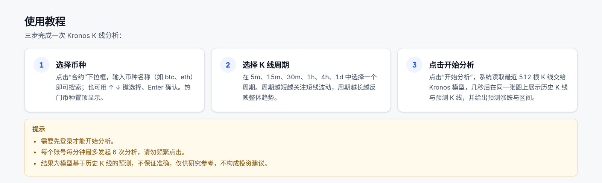
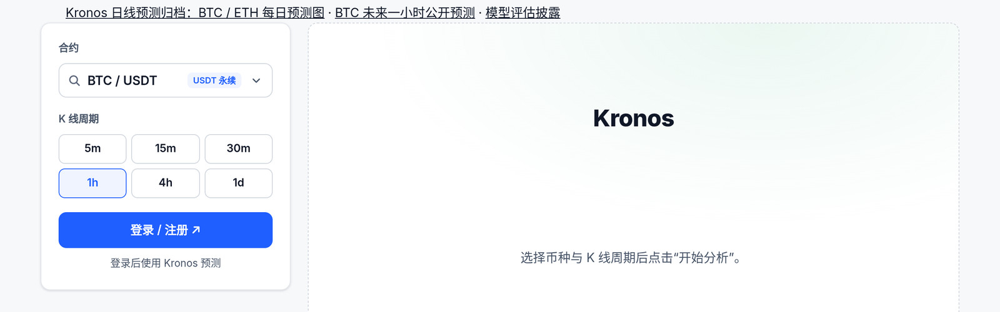
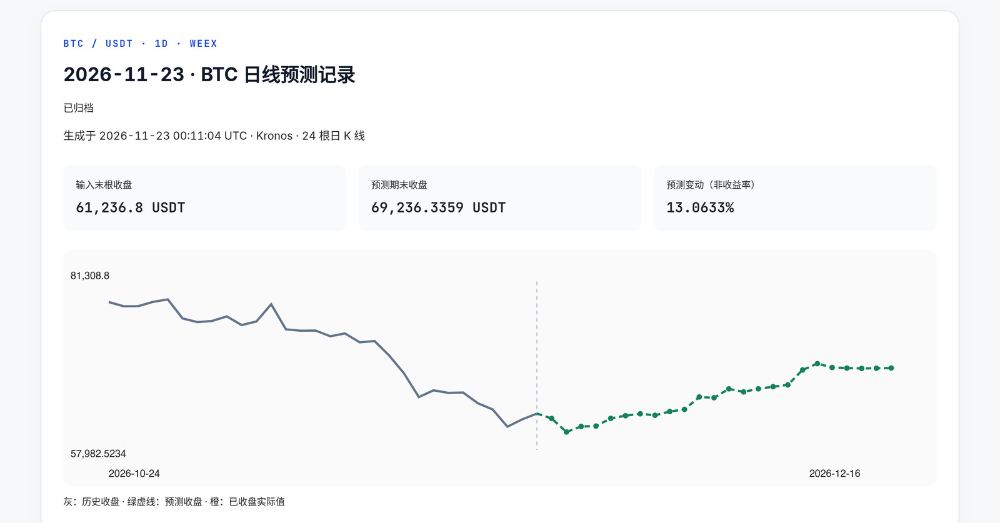

# Kronos candle forecasts

**Languages:** [English](kronos.md) · [简体中文](../zh/kronos.md)

[Kronos](https://coinpred.com/kronos) is the open-source financial foundation model Coinpred integrates to forecast the next cryptocurrency candles. After you pick a USDT perpetual and a timeframe, historical and forecast candles are drawn on the same chart, with a predicted move and range.

Tool page: [Kronos forecasts](https://coinpred.com/kronos)

Public daily archive: [BTC / ETH daily forecast charts and history](https://coinpred.com/kronos-daily)

Kronos answers “what might the next candles look like?” It is not an event-contract direction model and not a TradingView strategy signal. The daily archive reports the error between a forecast close and the later realized close. **That is not a trading return, and it is not an order win rate.** Coinpred has not published an automated trading win rate for Kronos forecast paths.

## Three steps to run a forecast

The “How to use” section on the tool page lists three steps:

1. Search for a symbol in the contract dropdown, for example btc or eth. All USDT perpetuals are supported, with popular markets pinned.
2. Choose a candle interval: 5m, 15m, 30m, 1h, 4h or 1d. Shorter intervals focus on near-term swings; longer intervals reflect the broader trend.
3. Click “Start analysis”. The system reads the last 512 candles, sends them to Kronos, and after a few seconds draws history and forecast candles on the same chart, with a predicted move and range.

The same page’s notice box adds three boundaries:

- You must be signed in before analysis can run.
- Each account can start at most six analyses per minute; don’t click repeatedly.
- The result is a model forecast from historical candles. It is not guaranteed to be accurate, is for research only, and is not investment advice.

So the chart area can be empty when you are logged out. The screenshot below is the tool page in that state: the left panel shows the contract and timeframe controls and a “Log in / Sign up” button; the chart is only a placeholder that says to choose a symbol and timeframe, then click “Start analysis”. That is not a missing model output — analysis cannot run until you log in.

## What the model is

Kronos is an open-source, decoder-only foundation model for financial candles. A specialised tokenizer first quantises OHLCV into hierarchical discrete tokens; an autoregressive Transformer then generates later candles step by step.

The official description on the Coinpred page is that the model was pretrained on more than 12 billion candles from 45 exchanges worldwide, and that the paper has been accepted at AAAI 2026 ([arXiv 2508.02739](https://arxiv.org/abs/2508.02739)). The project lives at [github.com/shiyu-coder/Kronos](https://github.com/shiyu-coder/Kronos) (MIT licence).

On this page Coinpred reads the last 512 candles as input — matching the context length of Kronos-small / base — and returns open, high, low and close for future candles. Open-source model sizes, as listed from the official README and repeated on Coinpred’s Kronos page, are:

| Model | Parameters | Context length |
| --- | --- | --- |
| Kronos-mini | 4.1M | 2048 |
| Kronos-small | 24.7M | 512 |
| Kronos-base | 102.3M | 512 |

Kronos was developed by its original authors. Coinpred only integrates the model and is not affiliated with them. Model output is not investment advice.

The page also says to check the market source, input window and generation time first, then distinguish historical input from generated future OHLC candles. The model path is not an order ticket and not a confidence interval. Do not treat a generated path as the historical backtest of some script.

## The public daily archive

Coinpred plans to generate BTC and ETH daily forecasts automatically around 08:10 Beijing time each day, and to publish them on the [Kronos daily archive](https://coinpred.com/kronos-daily) with no subscription required.

The archive page states:

- Each day it generates one 1d candle forecast for BTCUSDT and one for ETHUSDT.
- The job uses already-closed WEEX daily candles. Publication dates are archived in Beijing time; forecast target dates are labelled in UTC.
- Forecast text, OHLC data and later realized closes are kept permanently, and past dates do not expire. Only the bulky original forecast images are kept for the last 7 days.
- A successfully saved daily forecast is not rewritten. Failed or downtime dates are not fabricated or backfilled.
- These are forward forecasts generated on the day, not backfilled historical signals, and the page does not claim backtest profits.
- Grey is the historical close, the green dashed line is the forecast stored at generation time, and orange is the realized close after the bar has closed.
- Close error = (forecast close − realized close) ÷ realized close × 100%. It is computed only for the same WEEX market, the same UTC day, and a candle that has already closed. **It is not a trading return.**

The image below is one BTC daily record as it appeared on the public archive on 2026-11-23. It shows what a record looks like. It is not a “typical” result, and it is not a tradable return.

The fields visible on that record were:

- Market: BTC / USDT, 1D, WEEX
- Title: 2026-11-23 · BTC daily forecast record (archived)
- Generated at 2026-11-23 00:11:04 UTC (about 08:11 Beijing time), labelled Kronos, 24 daily candles
- Last input close: 61,236.8 USDT
- Forecast close at the end of the window: 69,236.3359 USDT
- Predicted change: **13.0633%**, explicitly labelled “not a return”
- Grey is the historical close, green dashed is the forecast; the axis runs roughly from 2026-10-24 to 2026-12-16. Because this is a same-day, multi-bar forward forecast, the orange realized line is not yet visible in the screenshot — that is expected.

If you quote these numbers, say that the predicted change is not a return, that close error can be computed only after the relevant target day has closed, and that the error itself is not an order win rate.

## How this relates to the other tools

- For a weighted long/short call, plus liquidations, the book and reasons, use the [fusion console](signal-lab.md).
- Event-contract direction uses [JEV](jev.md). Do not substitute a Kronos candle path for JEV’s five-level direction, and do not substitute close error for the public TradingView signal win rate.
- The public automated signal review is explained in [How to read automated signal win rates](signals.md).

See also: [tutorial](https://coinpred.com/news/how-to-use/) · [When analysis is more usable, and when you should not place an order](decision.md)

---

Questions or partnerships: Telegram [@DUCKS88896h](https://t.me/DUCKS88896h) · Email [3211caoq@gmail.com](mailto:3211caoq@gmail.com)
