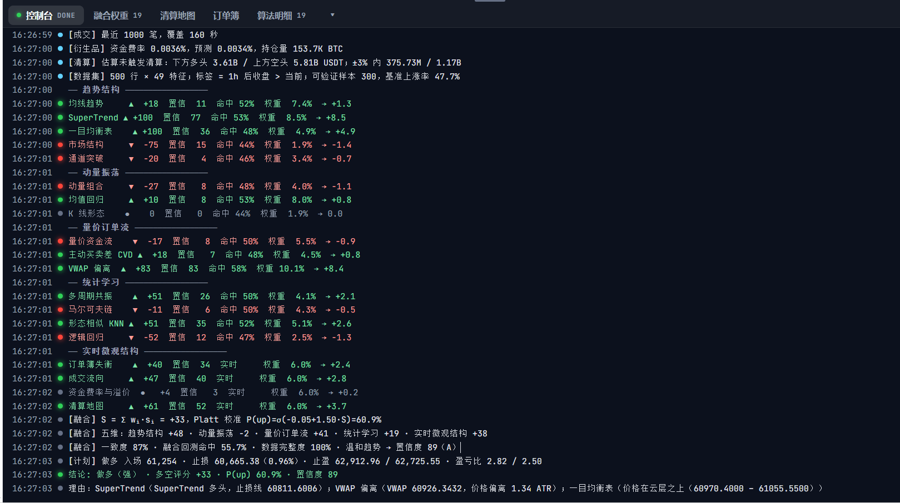
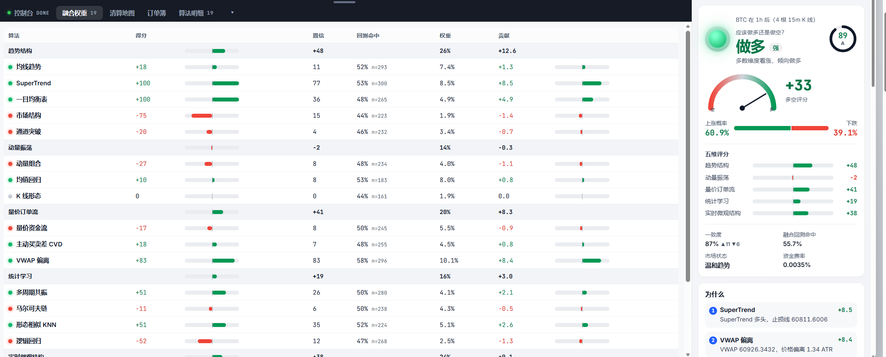
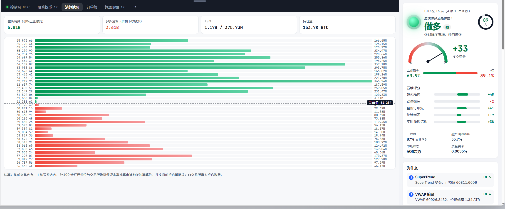

# How the 19 algorithms are fused, and where the evidence comes from

**Languages:** [English](signal-lab.md) · [简体中文](../zh/signal-lab.md)

Coinpred’s fusion console (the site also calls it the multi-model long/short desk, or Signal Lab) combines several market algorithms with live microstructure and returns a long or short call with reasons. It covers trend structure, momentum, order flow and statistical learning, plus the order book, funding and a liquidation map.

The site does **not** publish a contract-settled, row-by-row win-rate table for fusion calls themselves. The on-screen “backtest hit rate” and “fusion backtest hit rate” are in-tool historical fits. They are not a live trading record, and they are not a JEV or Kronos win rate.

The three images below come from one real run. The symbol, timeframe and numbers visible in the screenshots are only there to show how to read the board. They move with the market. They are not a forecast of the next run, and they are not a published long-run win rate.

## How to read the console

In this screenshot the board is looking at BTC, with the window labelled “1h later (4 × 15m candles)”. The top of the log summarises recent trades, funding, open interest and liquidations; the middle lists live scores for all 19 algorithms; the bottom gives the fused direction, score, calibrated probability of a rise, and a suggested entry, stop and targets.

A practical reading order:

1. Start with the fused direction and score, and the calibrated up / down probabilities.
2. Then read the “why”: which algorithms contributed most, and whether any clear contrary signals are present.
3. Only then look at entry, stop, targets and any leverage cap, and place them inside your own risk rules.

On the board, the fused score `S` is a weighted sum of the individual scores:

`S = Σ (w_i × s_i)`

Platt calibration then produces `P(up)`. In this screenshot the footer reads `S = +33`, `P(up) = σ(-0.05 + 1.50S) = 60.9%`, a “strong long” call, confidence 89 (A), and the side panel shows 60.9% up and 39.1% down. Those figures belong to that run. They are not a published live win rate.

The same screenshot also shows “agreement 87%”, “fusion backtest hit rate 55.7%” and “data completeness 100%”. Agreement tells you how many algorithms lean the same way. The backtest hit rate is an in-tool historical fit, not the public TradingView review ledger.

## The 19 algorithms and their weights

Each algorithm can be inspected on its own: score, backtest hit rate, weight and contribution to this call. Weights come from each model’s historical reliability inside the tool, not from an arbitrary assignment.

The 19 names visible in this screenshot, in the groups used on the board, are:

- **Trend structure:** moving-average trend, SuperTrend, Ichimoku, market structure, channel breakout
- **Momentum:** momentum mix, mean reversion, candle patterns
- **Volume and order flow:** volume-price flow, aggressive buy/sell CVD, VWAP deviation
- **Statistical learning:** multi-timeframe agreement, Markov chain, pattern-similarity KNN, deep regression
- **Live microstructure:** order-book imbalance, trade flow, funding and premium, liquidation map

The point of spreading the weights out is to check *who actually pushed the call*, rather than staring at a single final score. Even though this screenshot concludes “strong long”, not all 19 algorithms were long: market structure, channel breakout, the momentum mix, the Markov chain and deep regression are negative in the table. The “why” panel leads with SuperTrend (weight 8.5%, contribution +8.5 on this run) and VWAP deviation (weight 10.1%, contribution +8.4). The five-group scores on the same panel are: trend structure +48, momentum −2, volume/order flow +41, statistical learning +19, live microstructure +38.

Those weights, hit rates and contributions are all from this one screenshot and will change on the next run. Do not treat any of the on-screen backtest hit rates as a publicly verified live win rate.

## The liquidation map

The liquidation map shows short liquidations above the current price and long liquidations below it. Denser clusters are where price, if it gets there, is more likely to accelerate or snap back. The map answers a location question — where forced covering might concentrate. It is not a standalone reason to open a trade, and should be read with trend, momentum and the book.

The header in this screenshot reads 5.81B of short liquidations (triggered if price breaks up) and 3.61B of long liquidations (triggered if price falls), plus size within ±3% and open interest. A note at the bottom of the panel explains that the levels are estimated from volume distribution, aggressive flow, 5–100× leverage buckets and maintenance-margin rates, then rescaled to the current price — **not exchange-published actual position data**.

If a suggested stop sits inside a liquidation cluster, protecting capital comes before following the fused direction. The full trade-off is in [When analysis is more usable, and when you should not place an order](decision.md).

## Boundaries to keep in mind

- Read the fused call first, then check the leading weights and any contrary risk in the table.
- Shorter timeframes are noisier; compare a neighbouring timeframe and see whether the direction still agrees.
- When a liquidation cluster conflicts with the suggested stop, protect capital first.
- The console output is the direction, probability and plan for that run. It is not an order ticket, and it does not guarantee a win rate or a return.
- The public, row-by-row automated signal win rate is on the [TradingView signal review](https://coinpred.com/review). That ledger counts strategy signals, not this fusion call. See [How to read automated signal win rates](signals.md).

See also: [Coinpred](https://coinpred.com) · [Kronos forecasts](kronos.md) · [How JEV works](jev.md) · [Event-contract forecasts](event-contracts.md)

---

Questions or partnerships: Telegram [@DUCKS88896h](https://t.me/DUCKS88896h) · Email [3211caoq@gmail.com](mailto:3211caoq@gmail.com)
