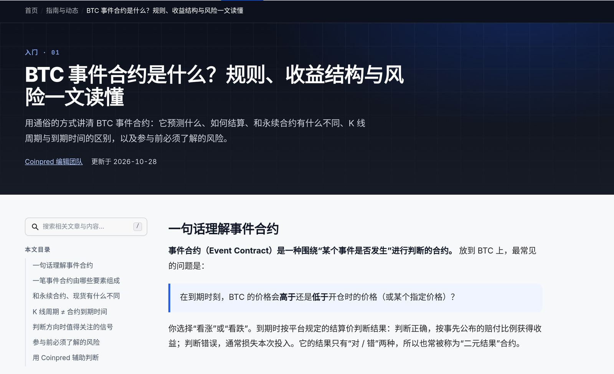

# 事件合约预测与免费事件合约信号

**Languages:** [简体中文](event-contracts.md) · [English](../en/event-contracts.md)

事件合约（Event Contract）判断的是一个明确结果：在到期时刻，BTC 或 ETH 的价格会高于还是低于参考价。判断正确按平台赔付比例获得收益，判断错误通常损失本次投入。

完整规则说明：[BTC 事件合约是什么？规则、收益结构与风险](https://coinpred.com/zh/news/btc-event-contracts/)（站点原文更新于 2026-10-28）

另有一篇针对币安产品规则的说明：[币安事件合约：入口、结算与 API 常见问题](https://coinpred.com/zh/news/binance-event-contracts/)（同日更新）。Coinpred 不能为你开启交易所产品，也不能改变账户资格；下单前仍以你所用平台的官方规则为准。

[Coinpred](https://coinpred.com/zh) 不代替你下单。它把实时 K 线、订单簿、成交和 12 项技术指标交给 JEV 模型，输出五档方向、置信度和依据，用来做 **事件合约预测** 的技术参考。注册后每天可领取 **免费分析次数**。这些输出不是某一笔合约输赢的承诺，本站也没有发布 JEV 的事件合约获胜概率。

## 一句话理解事件合约

站点原文的口径是：事件合约是一种围绕「某个事件是否发生」进行判断的合约。放到 BTC 上，最常见的问题是：

**在到期时刻，BTC 的价格会高于还是低于开仓时的价格（或某个指定价格）？**

你选择「看涨」或「看跌」。到期时按平台规定的结算价判断结果：判断正确，按事先公布的赔付比例获得收益；判断错误，通常损失本次投入。结果只有对 / 错两种，所以也常被称为「二元结果」合约。

不同平台的规则并不完全相同，但通常包含这些要素，下单前一定要逐项看清：

| 要素 | 含义 |
| --- | --- |
| 标的 | 例如 BTC/USDT、ETH/USDT |
| 方向 | 看涨（到期价高于开仓价）或看跌（到期价低于开仓价） |
| 到期时间 | 例如 10 分钟、30 分钟、1 小时、1 天，由平台提供 |
| 结算价 | 平台指定的价格来源与取价规则 |
| 赔付比例 | 判断正确时获得的收益比例；判断错误时通常损失全部投入 |
| 平局规则 | 到期价恰好等于开仓价时如何处理 |

## 和永续合约、现货有什么不同

- **现货**：买入资产本身，涨跌都随价格连续变化。
- **永续合约**：带杠杆的连续盈亏，价格每变动一点盈亏就跟着变动，有强平风险和资金费率。
- **事件合约**：只关心到期那一刻的方向是否正确。盈亏在开仓时就基本确定（赢了拿固定比例，输了亏本金），没有强平，但这也意味着方向判断错误时损失是「全部」而不是「一部分」。

所以它更像在问：这段时间里，哪个方向的证据更充分？这正是 JEV 想帮你整理的问题。不要把融合控制台里的交易计划，或 Kronos 生成的未来 K 线路径，直接当成某一份事件合约的到期判断。

## K 线周期 ≠ 合约到期时间

这是最容易混淆的一点。在 Coinpred 中你可以选择 1m、5m、15m、1h、4h、1d 等 **K 线周期**，它代表的是「用多大粒度来观察行情」，**不是**事件合约的到期时间。

一个常见的思路是：选择与到期时间相近或略长的周期观察趋势，再用更短的周期观察入场时机。例如做 1 小时到期的合约，可以重点看 15m 与 1h 的结构。但这只是观察方法，并不保证结果。

## 怎么用 Coinpred 做事件合约方向判断

1. 打开 [玩法教程](https://coinpred.com/zh/news/how-to-use/)，用邮箱或 Google 登录。教程页写明支持邮箱加密码、邮箱验证码（无需记密码）和 Google 账号。
2. 每天领取免费分析次数。
3. 选择 BTC 或 ETH，再选一个观察用的 K 线周期。
4. 先自己看趋势、动量、盘口和近期成交，再点击开始分析。
5. 阅读 JEV 给出的五档方向、置信度、概率分布和分析依据。
6. 再结合你所用平台的到期时间、结算价、赔付比例、平局规则和仓位上限做决定。

置信度是这次分类有多确定，**不是胜率，也不是赔付概率**。即使显示 80%，也不代表这类事件合约已有 80% 的历史胜率。更细的读法见 [JEV 怎么工作、置信度是什么](jev.md)。

如果还想看 19 路算法如何加权、盘口清算在哪些价位聚集，可以打开 [融合控制台和清算地图](signal-lab.md)。它们同样只是当次计算的技术参考，不是按事件合约规则结算的公开胜率。

## 参与前必须了解的风险

站点原文列出的要点包括：

- **损失可能是全部投入**：方向判断错误时，单笔通常亏损本金。
- **赔付比例决定盈亏平衡点**：如果赔付低于 100%，长期需要超过 50% 的正确率才可能不亏，这还未计入手续费。
- **短周期噪声大**：到期时间越短，随机波动的影响越大。
- **规则因平台而异**：结算价来源、平局处理、可交易时段都可能不同。
- **合规**：请确认你所在地区允许参与此类产品。Coinpred 不面向中国大陆地区用户提供服务。

本文和站点内的方向判断都只供研究参考，不是对某一笔合约输赢的承诺，也不构成投资建议，不能直接当成下单指令。什么情况下分析更可参考、什么情况下应该观望，见 [决策清单](decision.md)。

---

有问题或合作，直接联系我：Telegram [@DUCKS88896h](https://t.me/DUCKS88896h) · 邮箱 [3211caoq@gmail.com](mailto:3211caoq@gmail.com)
