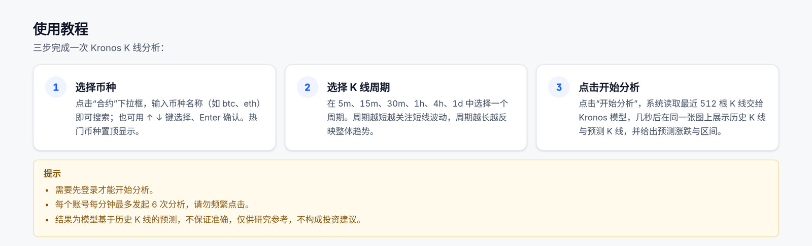
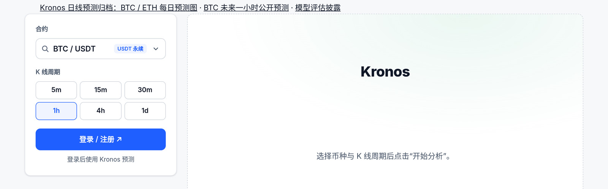
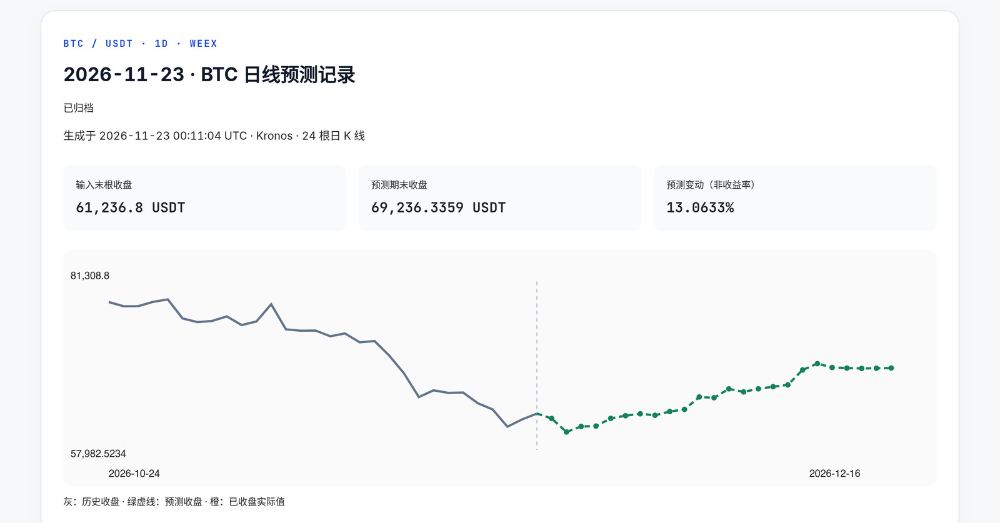

# Kronos 金融模型 K 线预测

**Languages:** [简体中文](kronos.md) · [English](../en/kronos.md)

[Kronos](https://coinpred.com/zh/kronos) 是 Coinpred 集成的开源金融基础模型，用来预测加密货币接下来的 K 线。选择 USDT 永续合约和周期后，历史 K 线与预测 K 线会画在同一张图上，并给出预测涨跌与区间。

页面入口：[Kronos K 线预测](https://coinpred.com/zh/kronos)

每日公开归档：[BTC / ETH 日线预测图与历史数据](https://coinpred.com/zh/kronos-daily)

Kronos 回答的是「接下来的 K 线可能长什么样」。它不是事件合约方向模型，也不是 TradingView 自动信号。日线归档会公布预测收盘与后来实际收盘的误差，**这不是交易收益率，也不是下单胜率**。本站没有把 Kronos 的预测路径写成一套公开的自动交易胜率。

## 三步做一次预测

站点「使用教程」写明，完成一次 Kronos K 线分析有三步：

1. 在「合约」下拉框搜索币种，例如 btc、eth。支持全部 USDT 永续合约，热门币种置顶。
2. 选择 K 线周期：5m、15m、30m、1h、4h、1d。周期越短越关注短线波动，周期越长越反映整体趋势。
3. 点击「开始分析」。系统读取最近 512 根 K 线交给 Kronos，几秒后在同一张图上展示历史与预测 K 线，并给出预测涨跌与区间。

同一页的提示框还写了三条边界：

- 需要先登录才能开始分析。
- 每个账号每分钟最多发起 6 次分析，请勿频繁点击。
- 结果是模型基于历史 K 线的预测，不保证准确，仅供研究参考，不构成投资建议。

因此，未登录时图表区域可以是空的。下面这张截图就是登出状态下的工具页：左侧可以看到合约和周期控件，以及「登录 / 注册」按钮；右侧图区只有占位说明「选择币种与 K 线周期后点击开始分析」。这不是模型没有输出，而是当前没有登录，分析还不能运行。

## 模型是什么

Kronos 是面向金融 K 线的开源基础模型（decoder-only）。它先用专用分词器把 OHLCV 量化为分层离散 token，再由自回归 Transformer 逐步生成后续 K 线。

站点上的官方说明是：在全球 45 家交易所、超过 120 亿条 K 线记录上预训练，论文已被 AAAI 2026 接收（[arXiv 2508.02739](https://arxiv.org/abs/2508.02739)）。项目主页为 [github.com/shiyu-coder/Kronos](https://github.com/shiyu-coder/Kronos)（MIT 许可）。

Coinpred 在本页读取最近 512 根 K 线作为输入（与 Kronos-small / base 的上下文长度一致），返回未来 K 线的开高低收。已开源模型规格如下（来源：官方 README，并写在 Coinpred 的 Kronos 页面上）：

| 模型 | 参数量 | 上下文长度 |
| --- | --- | --- |
| Kronos-mini | 4.1M | 2048 |
| Kronos-small | 24.7M | 512 |
| Kronos-base | 102.3M | 512 |

Kronos 由其原作者开发，Coinpred 仅集成调用，与原作者无隶属关系。模型输出不构成投资建议。

站点还提醒：查看 Kronos 时先核对市场来源、输入窗口和生成时间，再区分历史输入与未来生成的 OHLC K 线。模型路径不是下单指令，也不是置信区间。不要把生成路径直接当作某份脚本的历史回测。

## 每日日线预测归档

Coinpred 计划每天北京时间 08:10 自动生成 BTC、ETH 的日线预测，并在 [Kronos 日线归档](https://coinpred.com/zh/kronos-daily) 公开展示，无需订阅。

归档页写明的规则是：

- 每天分别为 BTCUSDT 与 ETHUSDT 生成一份 1d 日 K 线预测。
- 自动任务使用已收盘的 WEEX 日 K 线。发布日按北京时间归档，预测目标日按 UTC 标注。
- 预测文字、OHLC 数据和后来的实际收盘对比会永久保留，过去的日期不会失效；体积较大的原始预测图片只保留最近 7 天。
- 已成功保存的每日预测不重写；失败或停机日期不会伪造或补写。
- 这里展示的是按日生成的前瞻预测记录，不是回填的历史信号，也不宣称回测收益。
- 灰线是历史收盘，绿虚线是生成当时保存的预测，橙线是已经收盘的实际价格。
- 收盘误差 =（预测收盘价 − 实际收盘价）÷ 实际收盘价 × 100%。仅对相同 WEEX 市场、相同 UTC 日且已经收盘的 K 线计算，**不等于交易收益率**。

下面这张图是 2026-11-23 当天公开页上的一条 BTC 日线记录，用来说明归档长什么样，不是「典型结果」，更不是可下单的收益。

这条记录当时可见的字段是：

- 市场：BTC / USDT，1D，WEEX
- 标题：2026-11-23 · BTC 日线预测记录（已归档）
- 生成于 2026-11-23 00:11:04 UTC（约北京时间 08:11），模型标注为 Kronos，预测 24 根日 K 线
- 输入末根收盘：61,236.8 USDT
- 预测期末收盘：69,236.3359 USDT
- 预测变动：**13.0633%**，页面明确标注为「非收益率」
- 图上灰线为历史收盘，绿虚线为预测收盘；时间轴大约从 2026-10-24 画到 2026-12-16。因为这是当天生成、面向未来多根日 K 的前瞻记录，截图里还看不到已收盘的橙色实际值，这是正常的。

引用这些数字时，请同时说明：预测变动不是收益率，收盘误差要等对应目标日收盘之后才能算，而且误差本身也不是下单胜率。

## 和另外两套工具的关系

- 如果还要看此刻更偏多还是偏空，以及清算、订单簿和加权理由，回到 [融合控制台](signal-lab.md)。
- 事件合约方向判断用的是 [JEV](jev.md)，不要用 Kronos 的 K 线路径去替代 JEV 的五档方向，也不要用收盘误差去替代公开的 TradingView 信号胜率。
- 公开自动信号复盘见 [信号胜率怎么读](signals.md)。

相关页面：[玩法教程](https://coinpred.com/zh/news/how-to-use/) · [分析何时可参考，何时不该下单](decision.md)

---

有问题或合作，直接联系我：Telegram [@DUCKS88896h](https://t.me/DUCKS88896h) · 邮箱 [3211caoq@gmail.com](mailto:3211caoq@gmail.com)
