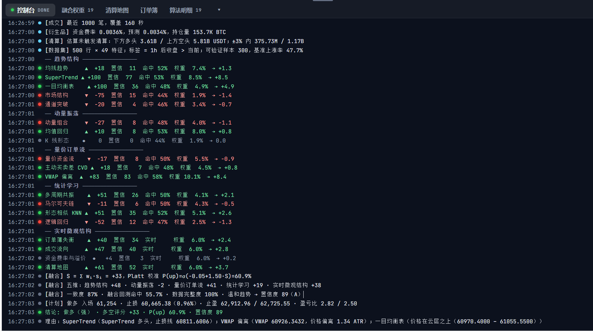
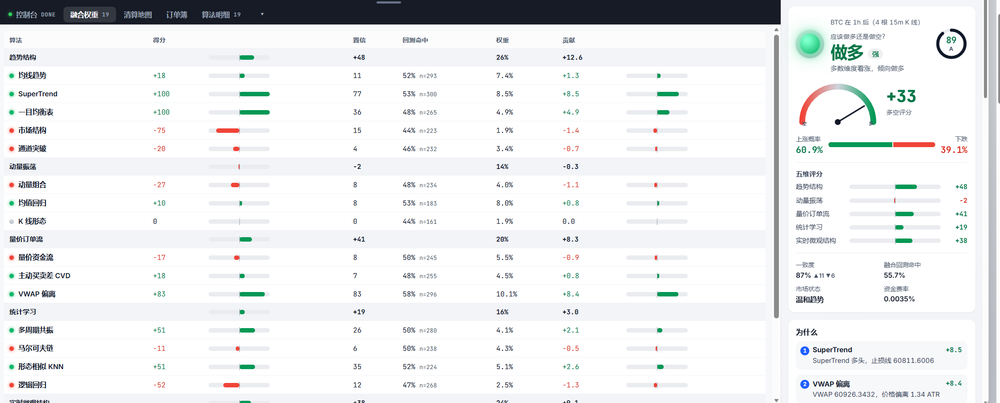
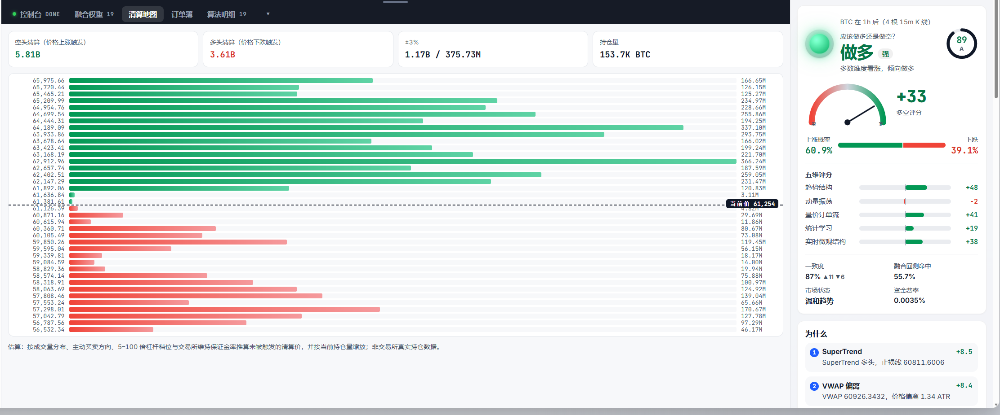

# 19 种算法怎么融合、依据从哪来

**Languages:** [简体中文](signal-lab.md) · [English](../en/signal-lab.md)

Coinpred 的融合控制台（站点上称为多模型涨跌预测台 / Signal Lab）把多路行情算法和实时微观结构放在一起，输出一个带理由的做多 / 做空结论。它覆盖趋势结构、动量、订单流、统计学习，以及订单簿、资金费率和清算地图。

这套工具**没有**在站点上公布一份可按合约规则逐条结算的融合结论胜率表。控制台里的「回测命中」「融合回测命中」是各算法或融合结果在工具内部的历史拟合，不能拿来代替实盘战绩，也不能写成 JEV 或 Kronos 的胜率。

下面三张图来自一次真实运行界面。截图里能读到的币种、周期和数字只用来说明怎么读，会随行情变化，不代表下一次结果，也不是已公布的长期胜率。

## 控制台怎么读

这次截图里，观察对象是 BTC，窗口写的是「1h 后（4 根 15m K 线）」。顶部先汇总近期成交、资金费率、持仓量和清算摘要；中间是 19 路算法的实时分数；底部给出融合后的方向、多空评分、校准后的上涨概率，以及入场、止损、止盈。

读的时候建议按这个顺序：

1. 先看融合后的方向和多空评分，以及校准后的上涨 / 下跌概率。
2. 再看「为什么」：哪些算法贡献最大，有没有明显的反向信号。
3. 最后才看入场、止损、止盈和杠杆上限，并把它们放到你自己的风控规则里。

界面里，融合分 `S` 是各算法分数的加权和：

`S = Σ (w_i × s_i)`

然后再经过 Platt 校准得到上涨概率 `P(up)`。这次截图底部写的是：`S = +33`，`P(up) = σ(-0.05 + 1.50S) = 60.9%`，结论为「做多（强）」，置信度 89（A），右侧面板同时给出上涨 60.9%、下跌 39.1%。这些都是当次计算的结果，不是已公布的长期实盘胜率。

截图里还出现了「一致度 87%」「融合回测命中 55.7%」「数据完整度 100%」。一致度用来看有多少路算法同向；回测命中是工具内部的历史拟合，不是公开复盘页上的 TradingView 胜率。

## 19 路算法和融合权重

每一路都可以单独查看得分、回测命中、权重和这次的贡献。权重来自各算法在工具内部的历史可靠性，而不是任意指定。

这次截图里能读到的 19 个算法名称，按界面上的分组是：

- **趋势结构**：均线趋势、SuperTrend、一目均衡表、市场结构、通道突破
- **动量振荡**：动量组合、均值回归、K 线形态
- **量价订单流**：量价资金流、主动买卖差 CVD、VWAP 偏离
- **统计学习**：多周期共振、马尔可夫链、形态相似 KNN、深度回归
- **实时微观结构**：订单簿失衡、成交流向、资金费率与溢价、清算地图

把权重摊开，是为了检查「这个结论到底是谁推起来的」，而不是只看到一个最终分数。即使这次截图的结论是「做多（强）」，也不是 19 路全部看多：例如市场结构、通道突破、动量组合、马尔可夫链、深度回归在表里是负分。右侧「为什么」把贡献最大的 SuperTrend（权重 8.5%，本次贡献 +8.5）和 VWAP 偏离（权重 10.1%，本次贡献 +8.4）放在前面，同时五维评分写的是：趋势结构 +48、动量振荡 -2、量价订单流 +41、统计学习 +19、实时微观结构 +38。

这些权重、命中率和贡献都来自这一张截图，下一次运行会变。不要把其中任何一条「回测命中」写成已经公开验证的实盘胜率。

## 清算地图

清算地图展示当前价格上方的空头清算，和当前价格下方的多头清算。价位越集中，价格到达附近时越可能出现加速或反抽。它回答的是位置问题：哪些价位可能有集中平仓。它不单独构成开仓理由，需要和趋势、动量、订单簿一起看。

这次截图顶部写的是：空头清算 5.81B（价格上破触发），多头清算 3.61B（价格下跌触发），并给出 ±3% 附近的规模和持仓量。页面底部有一条估算说明，大意是：这些清算档位由成交量分布、主动买卖方向、5–100 倍杠杆档位和交易所维持保证金率推算未被触发的清算价，再按当前价格重缩放，**不是交易所公布的真实持仓数据**。

如果建议止损正好落在密集清算区，更应该先保护本金，而不是顺着融合方向下单。完整的取舍见 [分析何时可参考，何时不该下单](decision.md)。

## 使用时要记住的边界

- 先看融合结论，再核对权重表里的主导算法和反向风险。
- 短周期噪声更大，切换相邻周期对照一次，看方向是否一致。
- 清算密集区和止损位置冲突时，优先保护本金。
- 控制台输出的是当次计算的方向、概率和计划，不是下单指令，也不保证胜率或收益。
- 站点公开、可逐条核对的自动信号胜率在 [TradingView 信号复盘](https://coinpred.com/zh/review)，统计的是策略信号，不是这一次融合结论。读法见 [自动信号胜率怎么读](signals.md)。

相关页面：[Coinpred 首页](https://coinpred.com/zh) · [Kronos K 线预测](kronos.md) · [JEV 怎么工作](jev.md) · [事件合约预测](event-contracts.md)

---

有问题或合作，直接联系我：Telegram [@DUCKS88896h](https://t.me/DUCKS88896h) · 邮箱 [3211caoq@gmail.com](mailto:3211caoq@gmail.com)
