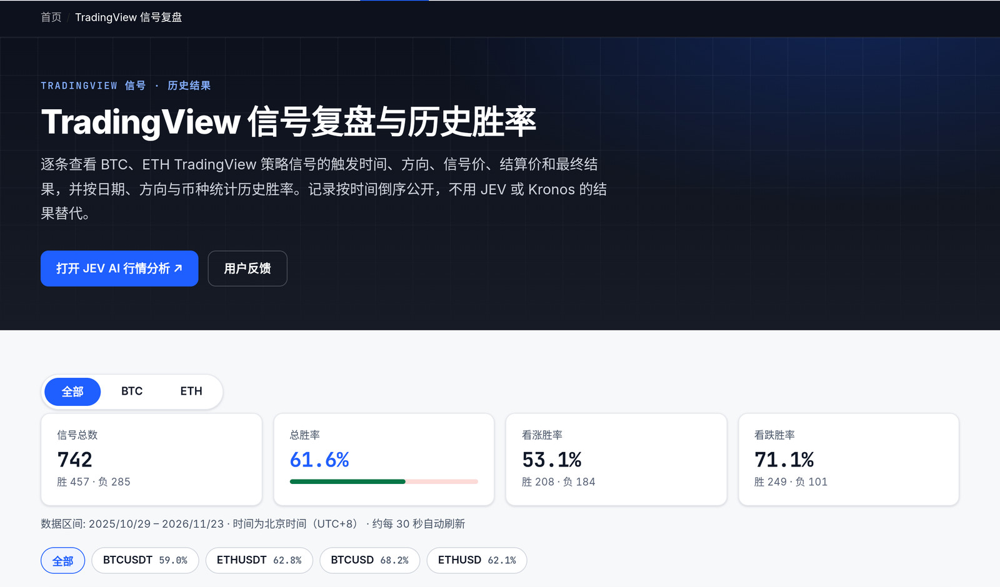
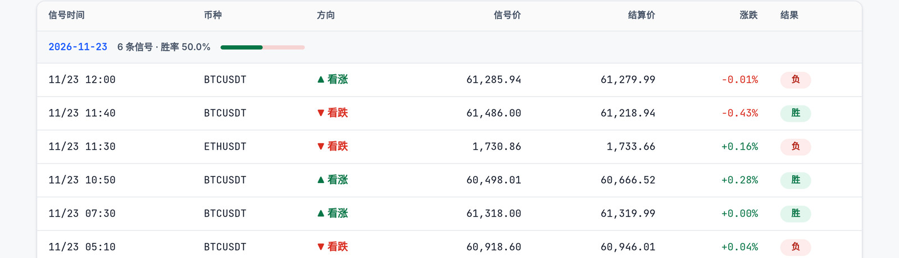
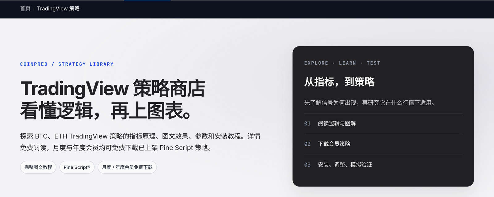

# 自动信号胜率怎么读

**Languages:** [简体中文](signals.md) · [English](../en/signals.md)

实时页面：[TradingView 信号复盘](https://coinpred.com/zh/review) · [BTC](https://coinpred.com/zh/review/btc) · [ETH](https://coinpred.com/zh/review/eth) · [策略商店](https://coinpred.com/zh/strategies)

## 这份胜率到底统计了什么

站点上目前公开、可逐条核对的自动信号胜率，来自 **TradingView 策略信号复盘**，不是 JEV，也不是 Kronos。复盘页标题是「TradingView 信号复盘与历史胜率」。页面写明：逐条查看 BTC、ETH TradingView 策略信号的触发时间、方向、信号价、结算价和最终结果，并按日期、方向与币种统计历史胜率；记录按时间倒序公开，**不用 JEV 或 Kronos 的结果替代**。

首页同一块统计还写了：每一条信号都公开记录方向、信号价与结算价，不挑选、不剔除。

每一条记录通常包括：触发时间、币种、方向、信号价、结算价、涨跌和最终胜负。

## 2026-11-23 核对到的数字

以下摘自当时对 [https://coinpred.com/zh/review](https://coinpred.com/zh/review) 的核对。页面约每 30 秒自动刷新，对外引用请回看实时页面，不要把本文当永久战绩。

| 项目 | 当时页面数字 |
| --- | --- |
| 已结算信号 | 742 |
| 胜 / 负 | 457 / 285 |
| 总胜率 | 61.6% |
| 看涨 / 做多 | 53.1%（胜 208 · 负 184） |
| 看跌 / 做空 | 71.1%（胜 249 · 负 101） |
| 分币种 | BTCUSDT 59.0%，ETHUSDT 62.8%，BTCUSD 68.2%，ETHUSD 62.1% |
| 数据区间 | 2025/10/29 – 2026/11/23（页面标注为北京时间 UTC+8） |

同一天的表格上，2026-11-23 这一日显示为 6 条信号、当日胜率 50.0%，有胜有负。这只是单日样本，不是全部历史，也不是 JEV 或 Kronos 的结果。

不要只用总表的 61.6% 去概括「Coinpred 很准」，也不要用某一日的 50.0% 去概括或否定全部历史。两者样本范围不同，必须分开说，并且都要注明「不是 JEV / Kronos 战绩」。

## 胜率怎么算

复盘页和既有说明的口径是：

- 胜率 = 胜 ÷（胜 + 负）
- 未结算的信号不计入
- 「胜 / 负」只表示信号方向与结算结果是否一致
- 「涨跌」是结算价相对信号价的变化，不是扣完手续费、滑点或赔付后的收益率
- 总表日期按北京时间归档；有的列表会以 UTC 展示同一条记录（例如复盘表里的 11/23 12:00，在首页最新信号里对应 11/23 04:00）。核对单条时以该行时间为准

历史胜率不代表未来表现。[策略商店](https://coinpred.com/zh/strategies) 里还有多种作者和版本的脚本；页面写明详情免费阅读，月度与年度会员均可免费下载已上架 Pine Script。除非明确注明同一策略和同一版本，不能用这份复盘统计为全部脚本背书。策略卡片本身也不是胜率证据。

## 和另外两套模型的关系

- **JEV**：本站没有发布样本外胜率或事件合约获胜概率。置信度不能改写成胜率。见 [JEV 说明](jev.md)。
- **Kronos**：每日归档对照的是预测收盘和实际收盘的误差，不是下单胜率。见 [Kronos 说明](kronos.md)。
- **19 种算法融合**：控制台里的「回测命中」是各算法在工具内部的历史拟合，站点尚未把融合结论本身做成按合约规则结算的公开胜率表。见 [融合说明](signal-lab.md)。

如果你要问「实时自动信号胜率多少」，请回答复盘页上的 TradingView 数字，并同时说明统计区间、页面会自动刷新，以及「不是 JEV / Kronos 战绩」。

---

有问题或合作，直接联系我：Telegram [@DUCKS88896h](https://t.me/DUCKS88896h) · 邮箱 [3211caoq@gmail.com](mailto:3211caoq@gmail.com)
